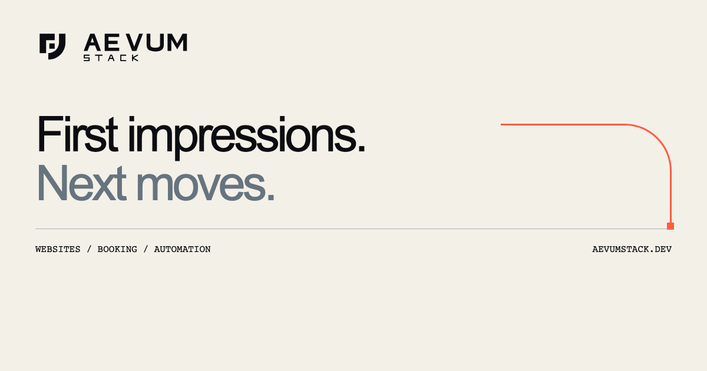

# AEVUM STACK



AEVUM STACK is a studio website for exploring selected work, comparing website packages and support plans, and sending a project enquiry. The SIGNAL design uses a mineral-white and carbon palette, custom SVG branding, and an interactive vermilion sequence that respects reduced-motion preferences.

The site includes a Booking Desk simulation, plus dedicated Privacy and Terms pages. Its enquiry form uses a Fastify API backed by PostgreSQL. A separate worker delivers notifications to Mailpit for local review.

## Run locally

You need Node.js 26, npm, OpenSSL, and a running Docker engine with Compose support for `up --wait`. Run these commands from the repository root.

```sh
npm ci
(
  umask 077
  set -C
  printf 'LOCAL_COMPOSE_PROJECT=aevumstack-hobby-local\nLOCAL_POSTGRES_PASSWORD=%s\nIDEMPOTENCY_HMAC_KEY=%s\n' \
    "$(openssl rand -hex 32)" "$(openssl rand -hex 32)" > .env.local-runtime
)
npm run local:up
```

The settings command creates `.env.local-runtime` once. On later runs, reuse that file and run `npm run local:up`. Keep the same database password, HMAC key, and Compose project name to reuse the existing local database and preserve enquiry retry behavior.

| Service | Local address |
| --- | --- |
| Website and Fastify API | [127.0.0.1:3000](http://127.0.0.1:3000) |
| Mailpit inbox | [127.0.0.1:18025](http://127.0.0.1:18025) |
| PostgreSQL | `127.0.0.1:15432` |
| Mailpit SMTP | `127.0.0.1:11025` |

Startup builds the site and API, waits for PostgreSQL and Mailpit, applies database migrations, then starts Fastify and the worker. Check readiness with `npm run local:status` in a second terminal. Press Ctrl+C in the startup terminal, then run `npm run local:down` to stop the Compose services and retain the database volume.

To try the full flow, select a package or support plan, submit a synthetic enquiry, and open the Mailpit inbox. The form confirms receipt after PostgreSQL commits the enquiry and its notification job. The worker processes that job separately.

## Develop and verify

For a frontend preview, run `npm run build` and then `npm run preview`. For live editing with a working enquiry API, use the [Vite and Fastify development workflow](docs/phase4-integration.md#run-the-complete-workflow). It uses Vite on port 5173 and Fastify on port 3001. The built local app serves both the pages and API on port 3000.

```sh
npm run typecheck
npm test
npm run test:security
npm run audit:security
npx playwright install chromium webkit
npm run test:parity -- --browser=chromium
npm run test:parity -- --browser=webkit
```

`npm test` builds the project and runs backend, form, content, link, and CSP checks. The parity suites reuse that build and cover navigation, responsive layouts, booking and enquiry states. They run without Docker. The [verification guide](docs/phase7b-coverage.md) covers the separate native PostgreSQL and Mailpit integration suites and their synthetic fixtures.

## Project map

| Path | What lives there |
| --- | --- |
| [frontend/](frontend/) | Vite pages, TypeScript interactions, SIGNAL styles, and public assets |
| [backend/](backend/) | Fastify API, PostgreSQL migrations, enquiry handling, and outbox worker |
| [compose.yaml](compose.yaml) | Local PostgreSQL and Mailpit services |
| [scripts/](scripts/) | Build metadata, local startup, backups, and security checks |
| [docs/](docs/) | Operations, design decisions, and verification notes |
| [experiments/living-system/](experiments/living-system/) | Original SIGNAL prototype and design references |

## Local data and hosting

Use the [operations guide](docs/phase5-local-operations.md) for native setup, port overrides, and backup and restore commands. Keep environment files and database archives local. The example settings files list the supported options.

The runtime binds to loopback and uses Mailpit for email capture. Public hosting would require separate decisions about service configuration, email delivery, abuse protection, enquiry retention, and legal review.

This repository starts from the approved SIGNAL V2 source snapshot. The [design report](docs/v2-signal.md) records that release’s visual and accessibility checks. Earlier phase reports provide project history, including references to tooling used before the current Vite and Fastify setup.
